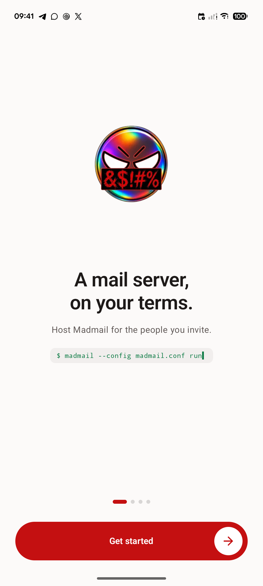
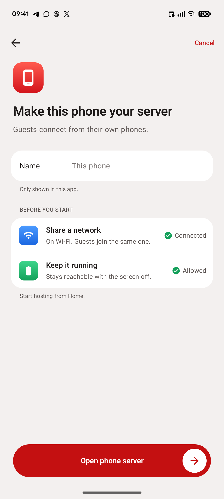
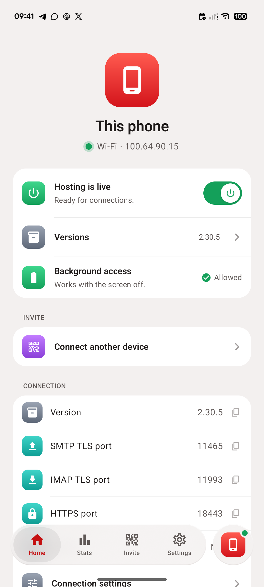
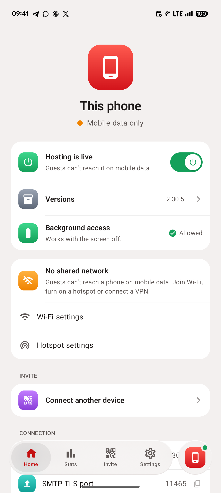
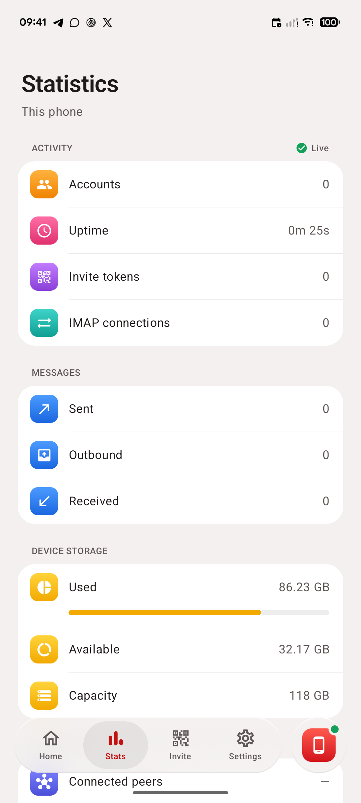
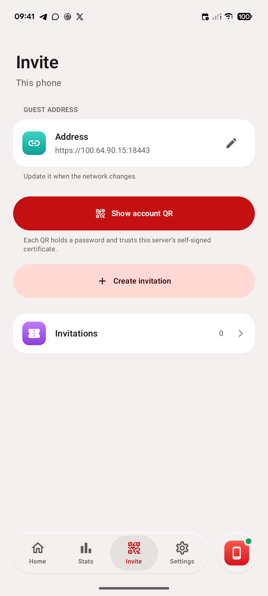
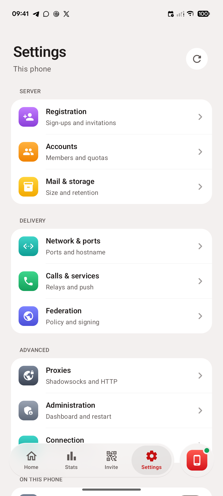
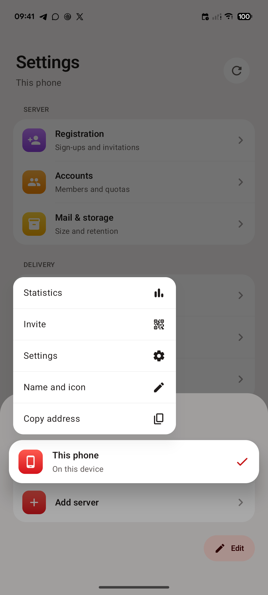

# Madmail Mobile

A Kotlin Android host and management UI for a local Madmail server. Guests use Delta Chat; this app is not a messaging client.

## Screenshots

Unedited captures from a Pixel 6a running the current development build. The status bar uses Android's demo mode for a fixed clock; no account QR, password or token is shown.

<p>
  
  
  
  
</p>
<p>
  
  
  
  
</p>

The app has four tabs: **Home** (power, versions, connection), **Stats** (live counters, storage and federation), **Invite** and **Settings**. The button beside them switches servers; long-press a server in that list for quick actions (open a tab, rename, copy its address, remove).

## Current implementation

See [feature status and remaining work](docs/feature-status.md) for the completion audit. Optional **App lock** in Settings protects management of every saved server with the phone's system authentication while hosting continues.

ARM64 Android hosting with upstream Madmail 2.30.5: foreground service, start/stop, authenticated readiness, live overview metrics, persistent private database/TLS identity, and packaged-version selection. Engine startup verifies its pinned SHA-256. A small native launcher terminates the engine if its owning Android process dies.

Android updates download a signed Madmail Mobile APK over HTTPS, check its package, signer and increasing app version, then hand installation to Android. Loose downloaded executables cannot be activated by a modern unrooted Android app. The version dialog loads stable releases directly from GitHub, marks installed versions, and offers Android packages when present. Releases without an APK remain visible. A signed package URL can also be supplied. Upstream has not published Android packages yet. Native updates create a cold private backup before first opening existing data with a newer engine. Automatic data downgrades are blocked.

Remote SSH management supports explicit host-key trust, generated/imported SSH keys and memory-only passwords, verified upstream release downloads, app-owned systemd installs, start/stop, authenticated overview through an SSH tunnel, retained-version inventory/removal, and cold backups before upgrades. Lifecycle management requires Linux ARM64/x86-64 and root or passwordless sudo. Existing servers can instead use a supplied API token through the key-authenticated SSH tunnel, or a trusted HTTPS admin endpoint without SSH. Saved keys and tokens are encrypted with Android Keystore; see [remote authentication](docs/remote-authentication.md). It refuses to adopt existing Madmail/maddy installations automatically. Automatic update feeds, backup restoration UI, root port forwarding, and complete web-admin parity are not implemented.

Settings uses grouped subpages with live API controls, account quotas, masked secret editors, copyable connection details and managed local/SSH restart. See [settings behavior and limits](docs/settings-flow.md).

Invite now creates real server-scoped invitation links with labels, use limits, expiry, usage and revocation, or a personal Delta Chat account QR with explicit connection settings. Copy, text/image sharing, an enlarged scanning view, and editable guest-facing addresses are available. The guest-address picker separates Wi-Fi/hotspot/VPN interfaces, reads remote addresses over SSH, and checks listener ports. Account QR is the default; browser links are refused when the server's invitation page names a different address than the chosen one. See [invitation behavior and validation](docs/invitation-flow.md).

Phone ports: SMTP TLS **11465**, IMAP TLS **11993**, HTTPS **18443**. The internal admin HTTP listener is loopback-only on **18080**. The mail domain and self-signed certificate use the phone's current guest IP address, never a `.local` name. Explicit account-QR login, SecureJoin and encrypted text/reply delivery are verified between two separate Delta Chat profiles on the Pixel; another physical LAN guest, offline networking and Tailscale still need validation. See [device verification](docs/invitation-flow.md).

See [the product and architecture brainstorm](docs/architecture.md) for scope, root design, compatibility gates, and implementation milestones.

## Releases

Download the latest APK from [GitHub Releases](https://github.com/themadorg/madmail-phone/releases). Every release is signed with the same key; the certificate SHA-256 is `3a03365df303f177286f3abdcda98f9907a4648e94b54e7a88027ed52912b81f`.

Pushing a `v*` tag that matches `release.properties` makes GitHub Actions test, build, sign, package and publish the release, using the notes in `docs/releases/<version>.md`. Versions before 1.0 are published as prereleases. See [release setup and signing](docs/releasing.md) for the signing secrets, versioning and acceptance gates.

## Build

Requires JDK 17, Android SDK 35, NDK 28.2.13676358, Rust/rustup, uv, bun, and network access for initial dependencies. This build supports ARM64 Android devices. Set `ANDROID_HOME` or local `sdk.dir` in `local.properties`.

```sh
export ANDROID_NDK_HOME="$ANDROID_HOME/ndk/28.2.13676358"
./scripts/prepare-engine.sh
./gradlew :app:assembleDebug :app:testDebugUnitTest :app:lintDebug
```

APK: `app/build/outputs/apk/debug/app-debug.apk`. Minimum Android 8.0/API 26. This development bootstrap targets API 35; reassess target SDK and local-network permissions before distribution. No signing keys or server secrets belong in this repository.


Release APKs must use a stable signing key and increasing `-PappVersionCode=N -PappVersionName=X`. Never distribute the development signing key. `scripts/prepare-engine.sh` builds a missing engine from pinned upstream source with the checked-in Android storage patch; it requires Rust/rustup and uv in addition to the NDK. `scripts/build-engine.sh` uses locked Cargo dependencies and cargo-zigbuild 0.24.0, records binary/patch hashes in the packaged manifest, and does not commit the binary. Review the manifest change after rebuilding. The upstream license is included in app assets. Source revision and patch are documented in [engine lifecycle](docs/engine-lifecycle.md).

See [engine lifecycle and validation](docs/engine-lifecycle.md) for storage paths, update behavior and the SSH integration fixture.
